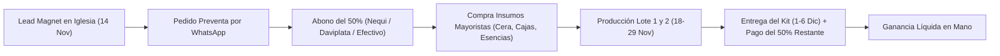

# Plan Financiero, Estructura de Costos y Estrategia de Precios
## Emprendimiento "Velas G12" — Noche de Velitas y Temporada Navideña (Colombia)

**Moneda de Referencia:** Peso Colombiano (COP)  
**Mercado Objetivo:** Bogotá y Colombia (Comunidad de fe, iglesias cristianas, familias)  
**Temporada Clave:** Preventa (Noviembre) y Noche de Velitas (7 de Diciembre)  
**Meta de Margen Bruto:** $\ge 60\%$

---

## 1. Justificación y Benchmarking de Mercado

En Colombia, la Noche de las Velitas (7 de Diciembre) es una de las celebraciones de mayor consumo masivo del año. Sin embargo, el mercado tradicional está saturado de velas de parafina corriente de supermercado que:
- Arden en menos de 20 minutos con llama inestable.
- Desprenden humo negro (hollín) y residuos tóxicos.
- Carecen de aroma y no aportan una experiencia significativa para la devoción familiar.

La propuesta de **Velas G12** se posiciona en el segmento **Artesanal Premium Espiritual**, combinando materias primas limpias (mezcla de cera de soya botánica con parafina refinada), aromaterapia de alta concentración, estética de lujo (pan de oro, acabados en aerografía y yeso cerámico curado) y un concepto de **revelación espiritual al centro de la vela**.

Los costos unitarios a continuación están basados en cotizaciones mayoristas en los principales centros de abastecimiento de insumos químicos, ceras, molduras y artes gráficas en Bogotá (Sector Ricaurte, Paloquemao, San Victorino y distribuidores autorizados de esencias grado perfumería).

---

## 2. Estructura Detallada de Costos Unitarios de Producción (Escandallo de Costos Variables)

### 2.1. Producto Insignia: Vela Magna de Revelación (Fanal Esférico ~350g)
*Vela central con quemado interno que revela en el corazón una figura angelical/inspiracional resistente al calor, con acabado exterior en pan de oro y aroma concentrado.*

| Rubro / Insumo | Descripción / Especificación Técnica | Cantidad / Consumo Unitario | Costo Base Mayorista (COP) | Costo Unitario Asignado (COP) |
| :--- | :--- | :--- | :--- | :--- |
| **Cera Base** | Mezcla formulada (70% Cera de Soya bajo punto de fusión + 30% Parafina Malasia 58/60) | 350 g | $24.000 / kg | $8.400 |
| **Esencia Aromática** | Grado perfumería fina liposoluble (Vainilla Celestial / Canela Navideña / Mirra) | 28 g (dosificación 8%) | $180.000 / kg ($18.000 / 100g) | $5.040 |
| **Pabilo y Soporte** | Mecha de algodón 100% trenzado ecológico encerado + portamecha metálico base ancha | 1 unidad (15 cm) | $500 c/u | $500 |
| **Figura Central** | Figura de Ángel / Símbolo de Fe en yeso cerámico odontológico Tipo IV tratado con sellador hidrófugo ignífugo | 1 unidad | $1.200 (molde silicona amortizado + yeso + sellador) | $1.200 |
| **Acabados Artísticos** | 2 láminas de pan de oro (hojilla imitación oro 8x8 cm) + goma laca / mordiente + pigmento perlado | 1 juego de aplicación | $800 por vela | $800 |
| **Empaque Primario** | Caja Kraft rígida calibre 320g con ventana de acetato transparente (12x12x14 cm) | 1 unidad | $2.600 c/u (lote x 100) | $2.600 |
| **Cintas y Presentación** | Cinta de satén/organza dorada o yute festivo (1.2 m) + viruta de madera decorativa | 1 juego | $850 por paquete | $850 |
| **Etiquetado y Marca** | Etiqueta adhesiva laminada mate frontal + etiqueta de instrucciones de uso y seguridad al respaldo | 2 unidades | $450 por set (impresión Ricaurte) | $450 |
| **Consumibles de Taller** | Gas propano / energía para baño de maría, guantes, papel absorbente, agitadores | Prorrateo unitario | $500 por vela | $500 |
| **TOTAL COSTO VARIABLE UNITARIO (CVU) VELA MAGNA** | | | | **$20.840 COP** |

---

### 2.2. Acompañamiento: Velitas Tradicionales Aromáticas (Unidad de ~35g)
*Velitas cilíndricas o estilizadas para encender en familia la noche del 7 de Diciembre, con formulación aromática de larga duración (queman 2.5 a 3 horas sin humear).*

| Rubro / Insumo | Descripción / Especificación Técnica | Cantidad / Consumo Unitario | Costo Base Mayorista (COP) | Costo Unitario Asignado (COP) |
| :--- | :--- | :--- | :--- | :--- |
| **Cera Base** | Mezcla parafina refinada + aditivo de brillo y endurecedor esteárico vegetal | 35 g | $18.000 / kg | $630 |
| **Esencia Aromática** | Concentrado aromático Canela-Manzana o Vainilla | 2.5 g (aprox. 7%) | $160.000 / kg | $400 |
| **Pabilo** | Pabilo encerado delgado número 1 o 2 con ojalillo | 1 unidad (8 cm) | $120 c/u | $120 |
| **Envase / Base** | Base de policarbonato ignífugo o copita de aluminio reutilizable | 1 unidad | $250 c/u (al por mayor) | $250 |
| **Toque Dorado** | Ribete con mica dorada ecológica o escarcha mineral no inflamable | Aplicación manual | $100 | $100 |
| **Consumibles** | Energía y gas de fusión | Prorrateo unitario | $100 | $100 |
| **TOTAL COSTO VARIABLE POR VELITA AROMÁTICA** | | | | **$1.600 COP** |
| **PACK DE 12 VELITAS (Insumos + Bolsita Organza / Caja Display + Etiqueta)** | 12 unidades ($19.200) + Estuche kraft/organza ($1.800) + Faja decorativa ($400) | 1 kit complementario | | **$21.400 COP** |

---

### 2.3. Herramienta de Prospección: Mini-Velitas de Muestra (Lead Magnet de Salida de Iglesia)
*Mini-vela tipo tealight de alta intensidad aromática entregada de obsequio a los asistentes a los cultos dominicales, con tarjeta devocional y código QR directo a la preventa por WhatsApp.*

| Rubro / Insumo | Descripción / Especificación Técnica | Cantidad / Consumo Unitario | Costo Unitario (COP) |
| :--- | :--- | :--- | :--- |
| **Cera Aromática** | Cera de soya de alto aroma (Vainilla Paz celestial) | 14 g | $350 |
| **Pabilo y Cápsula** | Mini cápsula de aluminio reutilizable + pabilo corto | 1 unidad | $220 |
| **Empaque de Prospección**| Bolsita transparente de polipropileno cristal con adhesivo (7x10 cm) | 1 unidad | $80 |
| **Tarjeta Lead Magnet** | Tarjeta física en cartulina propalcote 300g (tiro/retiro full color): - Frontal: Versículo bíblico navideño. - Posterior: "Escanea aquí tu bendición" + QR a WhatsApp con mensaje predeterminado. | 1 unidad | $280 (litografía x 500 u.) |
| **Toque de Cinta** | Mini lazo decorativo rojo/dorado | 1 unidad | $120 |
| **TOTAL COSTO UNITARIO LEAD MAGNET (CAC FÍSICO)** | | | **$1.050 COP** |

> **Nota Estratégica:** Con solo **$1.050 COP**, se adquiere un prospecto caliente calificado que ya experimentó la fragancia en sus manos y tiene el teléfono en mano para encargar su preventa. Si 1 de cada 8 personas que recibe la muestra compra un Kit Familiar ($95.000 COP), el Costo de Adquisición de Cliente (CAC) es de $8.400 COP por kit, representando apenas el 8.8% del valor de venta.

---

### 2.4. Costos de los Productos y Paquetes de Venta

#### Kit Luz Familiar 7 de Diciembre (Producto Estrella)
- **1 Vela Magna de Revelación (en caja individual de lujo):** Costo $20.840 COP
- **12 Velitas Aromáticas de Acompañamiento:** Costo $19.200 COP
- **Guía Devocional de Oración Familiar "Luz en el Hogar" (Folleto 4 páginas papel propalcote 150g satinado):** Costo de impresión $1.200 COP
- **Caja de Fósforos de Madera Largos Vintage Personalizados (estampado temático):** Costo $1.800 COP
- **Caja de Embalaje Familiar / Canastilla Kraft con visor, lazo de gala y viruta de protección:** Costo $3.800 COP
- **Total Costo Variable Kit Familiar:** **$46.840 COP**

#### Dúo Bendición (2 Velas Medianas de 200g c/u con pan de oro en caja dúo)
- **2 Velas Medianas Aromáticas con detalle dorado:** $11.500 c/u = $23.000 COP
- **Caja Doble Kraft con divisor y ventana:** $3.200 COP
- **Lazo, tarjetas de dedicatoria y etiquetas:** $1.300 COP
- **Total Costo Variable Dúo Bendición:** **$27.500 COP**

---

## 3. Estructura de Costos Fijos y de Operación de Temporada

Para la campaña de 30 días (10 de Noviembre al 10 de Diciembre), se contemplan los siguientes costos fijos asociados al taller artesanal y a la operación comercial:

| Rubro Fijo | Detalle Operativo | Presupuesto Total Mes (COP) |
| :--- | :--- | :--- |
| **Servicios Públicos Adicionales** | Gas y energía eléctrica incrementales por operación continua de estufas/hornos de fundición | $120.000 |
| **Herramental y Moldes (Depreciación)** | Moldes de silicona de ángeles, jarras dosificadoras de acero, termómetro digital infrarrojo | $150.000 |
| **Materiales de Publicidad Digital / Impresa** | Pendón de apoyo para la mesa de salida en la iglesia (80x180 cm) + volantes informativos | $140.000 |
| **Transportes y Fletes de Materias Primas** | Envíos y desplazamientos a centros mayoristas para acopio de insumos | $110.000 |
| **Línea WhatsApp Business & Empaquetado General** | Bolsas de entrega con logo, cinta de embalaje, stickers de seguridad de envío | $130.000 |
| **TOTAL COSTOS FIJOS DE TEMPORADA** | | **$650.000 COP** |

---

## 4. Escandallo de Precios de Venta, Márgenes y Política de Preventa

La estrategia de precios se basa en dos momentos clave:
1. **Fase de Preventa (Hasta el 30 de Noviembre):** Requiere un abono del **50%** para reservar. Ofrece un precio especial altamente atractivo que incentiva el flujo de caja temprano y elimina el riesgo de inventario no vendido.
2. **Fase de Temporada Alta (1 al 7 de Diciembre):** Precio regular de urgencia para compradores de última hora.

### 4.1. Matriz de Precios y Márgenes de Ganancia

| Producto / Paquete | Costo Unitario Variable (COP) | Precio Preventa (COP) *(Hasta 30 Nov)* | Margen Bruto Preventa (%) | Precio Temporada (COP) *(1-7 Dic)* | Margen Bruto Temporada (%) | Ganancia Bruta x Unidad (Temporada) |
| :--- | :--- | :--- | :--- | :--- | :--- | :--- |
| **Opción A: Vela Magna "Revelación de Paz"** | $20.840 | **$49.000** | **57.5%** | **$59.000** | **64.7%** | **$38.160 COP** |
| **Opción B: "Kit Luz Familiar 7 de Diciembre"** *(Estrella)* | $46.840 | **$115.000** | **59.3%** | **$135.000** | **65.3%** | **$88.160 COP** |
| **Opción C: "Dúo Bendición"** *(2 Velas medianas obsequio)* | $27.500 | **$69.000** | **60.1%** | **$82.000** | **66.5%** | **$54.500 COP** |
| **Pack Adicional 12 Velitas Aromáticas** | $21.400 | **$45.000** | **52.4%** | **$52.000** | **58.8%** | **$30.600 COP** |

> **Cumplimiento del Objetivo de Margen:** Todos los paquetes estrella en precio regular superan holgadamente el **64% de margen bruto**, y en preventa se mantienen entre **57.5% y 60.1%**, lo cual otorga un colchón financiero blindado para absorber costos de comercialización y muestras gratis.

---

## 5. Metas Comerciales, Punto de Equilibrio y Proyección de Utilidad Neta

### 5.1. Escenario Objetivo: 50 Kits Familiares + Ventas Cruzadas

Supongamos la meta base de producción y venta distribuida de la siguiente manera:
- **50 Kits Familiares "Luz de Sion"** (70% en Preventa a $115.000 COP, 30% en Temporada a $135.000 COP).
- **25 Velas Magnas Individuales** (60% Preventa a $49.000 COP, 40% Temporada a $59.000 COP).
- **20 Dúos Bendición** (50% Preventa a $69.000 COP, 50% Temporada a $82.000 COP).
- **Distribución de 300 Mini-velitas Lead Magnet** (Costo de adquisición: 300 x $1.050 = $315.000 COP).

#### A. Cálculo de Ingresos Totales (Ventas Proyectadas)

1. **Kit Familiar (50 unidades):**
   - 35 unidades en Preventa: $35 \times \$115.000 = \$4.025.000$ COP
   - 15 unidades en Temporada: $15 \times \$135.000 = \$2.025.000$ COP
   - *Subtotal Kit:* **$6.050.000 COP**

2. **Vela Magna Individual (25 unidades):**
   - 15 unidades en Preventa: $15 \times \$49.000 = \$735.000$ COP
   - 10 unidades en Temporada: $10 \times \$59.000 = \$590.000$ COP
   - *Subtotal Individual:* **$1.325.000 COP**

3. **Dúo Bendición (20 unidades):**
   - 10 unidades en Preventa: $10 \times \$69.000 = \$690.000$ COP
   - 10 unidades en Temporada: $10 \times \$82.000 = \$820.000$ COP
   - *Subtotal Dúo:* **$1.510.000 COP**

**INGRESOS TOTALES BRUTOS:** **$8.885.000 COP**

---

#### B. Costos Totales de Producción y Operación

1. **Costos Variables Directos:**
   - 50 Kits Familiares: $50 \times \$46.840 = \$2.342.000$ COP
   - 25 Velas Magnas: $25 \times \$20.840 = \$521.000$ COP
   - 20 Dúos Bendición: $20 \times \$27.500 = \$550.000$ COP
   - *Total Costos Variables de Producción:* **$3.413.000 COP**

2. **Inversión en Muestras / Lead Magnet:**
   - 300 mini-velitas con tarjeta QR: $300 \times \$1.050 = \$315.000$ COP

3. **Costos Fijos Operativos:**
   - Servicios, herramientas, fletes, publicidad física: **$650.000 COP**

**COSTOS TOTALES DEL PROYECTO:** **$4.378.000 COP**

---

#### C. Estado de Resultados Proyectado (P&L)

| Concepto Financiero | Valor en COP | % Sobre Ingresos |
| :--- | :--- | :--- |
| **Ingresos Operacionales Brutos** | **$8.885.000** | **100.0%** |
| (-) Costos Variables Directos de Producción | -$3.413.000 | 38.4% |
| **UTILIDAD BRUTA** | **$5.472.000** | **61.6%** |
| (-) Costo de Lead Magnets / Marketing Físico | -$315.000 | 3.5% |
| (-) Costos Fijos de Operación de Temporada | -$650.000 | 7.3% |
| **UTILIDAD NETA OPERACIONAL (Antes de Mano de Obra Dueño)** | **$4.507.000 COP** | **50.7%** |

> **Resultado Clave:** Con un capital circulante de aproximadamente **$2.500.000 COP** (financiado en un 80% con los anticipos del 50% de la preventa), el negocio genera una **utilidad neta de más de 4.5 millones de pesos libres en menos de 4 semanas**, alcanzando un rendimiento sobre la inversión (ROI) superior al **102%**.

---

### 5.2. Análisis de Punto de Equilibrio (Break-Even Point)

Si el negocio decidiera operar exclusivamente con el **Kit Luz Familiar** para simplificar su producción:
- **Precio Promedio Ponderado de Venta:** $\$121.000$ COP
- **Costo Variable Unitario:** $\$46.840$ COP
- **Margen de Contribución Unitario ($MC_u$):** $\$121.000 - \$46.840 = \$74.160$ COP
- **Costos Fijos Totales + Inversión en Muestras ($CF$):** $\$650.000 + \$315.000 = \$965.000$ COP

$$\text{Punto de Equilibrio (Unidades)} = \frac{\text{Costos Fijos Totales}}{MC_u} = \frac{\$965.000}{\$74.160} \approx \mathbf{13.01 \text{ Kits}}$$

> **Conclusión Financiera:** Con tan solo vender **13 Kits Familiares**, se recupera el 100% de los costos fijos y el costo total de las 300 muestras gratuitas entregadas en la iglesia. A partir del Kit número 14, cada kit vendido aporta **$74.160 COP limpios** a la ganancia neta del emprendimiento.

---

## 6. Flujo de Caja y Mecánica del Abono del 50%

Para blindar la tesorería del emprendimiento y no descapitalizarse:

1. **Cero Endeudamiento Externo:** El 50% de abono en preventa ($57.500 COP por kit) supera el costo variable total de producción del kit ($46.840 COP). Por lo tanto, **el cliente financia el 100% de la materia prima antes de que se vierta la primera gota de cera**.
2. **Medios de Pago Sugeridos:**
   - Nequi y Daviplata (códigos QR impresos en el reverso de la muestra física).
   - Transferencia Bancolombia a la Mano.
   - Efectivo directo mediante talonario numerado de pedidos en la mesa de atención tras el culto.
3. **Plíticas de Cobro:**
   - Pedido agendado formalmente solo con comprobante de transferencia o recibo de caja.
   - Saldo contra entrega al recoger en el punto de encuentro acordado o previo al despacho si es a domicilio.
