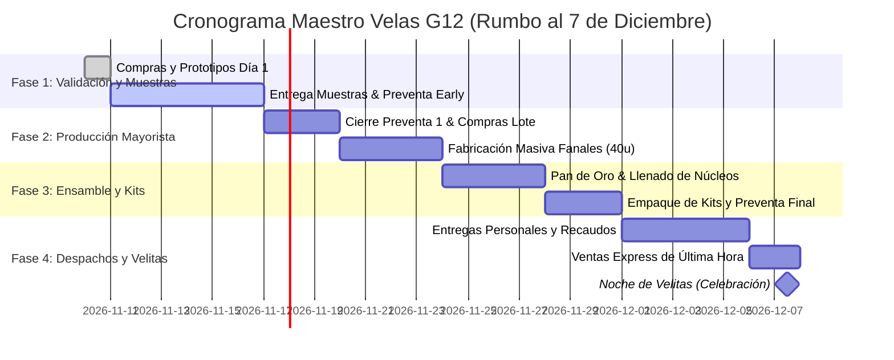

# 🚀 PLAN DE ACCIÓN INMEDIATO: "SALIR MAÑANA MISMO"
## Hoja de Ruta Operativa, Presupuesto Mínimo y Cronograma Hacia el 7 de Diciembre
**Emprendimiento:** Velas G12  
**Fecha de Inicio:** Día 1 (Mañana a primera hora)  
**Meta Inmediata:** 30 mini-velitas de muestra (Lead Magnets de gratitud) + 2 prototipos de fanal grande de revelación para video y preventa de 10 kits familiares.

---

## 1. GUÍA Y RUTA DE COMPRAS DE PRIMERA HORA (BOGOTÁ Y COLOMBIA)

Para optimizar tiempo y dinero, las compras deben realizarse en los clusters mayoristas tradicionales de insumos químicos, ceras y empaques.

### 1.1. Polos y Distribuidores Recomendados (Bogotá)
1. **Cluster Centro / La Candelaria / Carrera 13 (Calle 11 a Calle 16):**
   * **Químicos Campota / Distribuidores de Químicos Centro:** Ceras refinadas, esencias puras para velas, estearina, colorantes a la grasa y ojalillos.
   * **Distribuidoras de Parafinas y Ceras de Colombia:** Bloques de parafina nacional y china por bulto o kilo suelto.
2. **Cluster Ricaurte (Carrera 27 a 29 con Calle 9 a 13):**
   * **Litografías y tipografías rápidas:** Impresión de etiquetas adhesivas en vinilo o propalcote, tarjetas de presentación con código QR, corte guillotina inmediato.
   * **Cajas y empaques de cartón:** Cajas plegadizas microcorrugadas, papel seda, viruta de madera ecológica.
3. **Cluster Paloquemao / San Victorino:**
   * **Artesanías y piñaterías mayoristas:** Globos Sempertex R12 (paquete x 50 o x 100), bolsas de organza o celofán, mechas, cintas de yute o satín.
   * **Moldes de yeso y figuras:** Tiendas de insumos de imaginería religiosa o yesos cerámicos en el Centro (alrededores de la Basílica del Voto Nacional o Calle 10 con Cra 12).
4. *Nota para otras ciudades (Medellín / Cali / Barranquilla):*
   * *Medellín:* Sector Guayaquil / La Alpujarra o Químicos del Cauca / Bellchem.
   * *Cali:* Sector Centro (Carrera 8 y 9) / Químicos La 14.

### 1.2. Checklist de Compras para el Día 1 (No Olvidar Nada)
- [ ] 5 kg de Parafina Refinada 58–60°C (en pastillas o bloque blando).
- [ ] 2 kg de Cera de Soya de bajo punto de fusión.
- [ ] 500 g de Estearina vegetal.
- [ ] 2 frascos de 100 ml de Esencia concentrada grado vela (1 de Vainilla Francesa / Celestial y 1 de Canela & Manzana Navideña).
- [ ] 1 paquete de 50 Globos Sempertex R12 color blanco o pastel (látex grueso).
- [ ] 1 rollo de 10 metros de Pabilo encerado calibre 24 o 26 con 50 ojalillos metálicos.
- [ ] 30 bases de aluminio tipo "tea light" o vasitos de vidrio mini (para las muestras de gratitud).
- [ ] 10 figuras pequeñas de yeso cerámico (ángeles, querubines o cruz, de 4 a 5 cm).
- [ ] 1 talonario de láminas de Pan de Oro (imitación foil, paquete x 25 hojas).
- [ ] 1 frasquito de Mordiente al agua o goma laca.
- [ ] 1 termómetro digital de cocina tipo punzón (pantalla LCD, -50°C a +300°C).
- [ ] 1 paquete de 50 bolsitas de celofán transparente (8x12 cm) o bolsitas de organza dorada/blanca.
- [ ] 1 rollo de cinta de cabuya / yute o cinta satinada delgada (roja o dorada).

---

## 2. PRESUPUESTO DE ARRANQUE MÍNIMO VIABLE (MUESTRAS + PREVENTA)

El modelo está diseñado para iniciar con una inversión mínima (Bootstrap / Capital Semilla Familiar), recuperable con los primeros 3 kits de preventa vendidos.

### 2.1. Desglose en Pesos Colombianos (COP)

| Rubro / Ítem | Tipo | Cantidad | Costo Unitario (COP) | Costo Total (COP) |
| :--- | :--- | :--- | :--- | :--- |
| **Parafina Refinada 58-60 (kg)** | Fungible | 5 kg | $14.000 | $70.000 |
| **Cera de Soya (kg)** | Fungible | 2 kg | $22.000 | $44.000 |
| **Estearina Vegetal (kg)** | Fungible | 0.5 kg | $12.000 | $6.000 |
| **Esencias concentradas (100 ml)** | Fungible | 2 unidades | $25.000 | $50.000 |
| **Globos Sempertex R12 (paq x 50)** | Fungible | 1 paquete | $18.000 | $18.000 |
| **Pabilo encerado + Ojalillos** | Fungible | 50 unidades | $300 | $15.000 |
| **Figuras de yeso cerámico (ángeles)**| Fungible | 10 unidades | $2.500 | $25.000 |
| **Vasitos / latas para 30 muestras** | Fungible | 30 unidades | $800 | $24.000 |
| **Pan de oro (cuadernillo x 25)** | Fungible | 1 unidad | $16.000 | $16.000 |
| **Mordiente / adhesivo para foil** | Inversión (dura 200 velas) | 1 frasco | $10.000 | $10.000 |
| **Bolsitas + Cintas para muestras** | Empaque | 50 unidades | $400 | $20.000 |
| **Impresión tarjetas QR + Versículos**| Papelería | 100 tarjetas | $250 | $25.000 |
| **Termómetro digital de cocina** | Herramienta amortizable | 1 unidad | $22.000 | $22.000 |
| **Gramera digital (si no tiene)** | Herramienta amortizable | 1 unidad | $25.000 | $25.000 |
| **Fondo de Imprevistos / Transporte** | Logística | - | - | $30.000 |
| **TOTAL INVERSIÓN DÍA 1** | | | | **$370.000 COP** |

*(Equivalente aproximado a ~$90 - $95 USD).*

### 2.2. Retorno de Inversión (ROI) Inmediato con Preventa
- Costo de producción de 1 Kit Familiar Grande (1 Fanal con Ángel de 10 cm + 6 velitas aromáticas tradicionales + caja de regalo + cerillas de madera): **$22.000 COP**.
- Precio de Preventa de Lanzamiento al público: **$65.000 COP**.
- Margen bruto por kit: **$43.000 COP (66% de margen)**.
- **Punto de Equilibrio (Break-even):** Con la preventa de solo **6 Kits Familiares** ($390.000 COP recaudados), se recupera el 100% de la inversión inicial del Día 1 y quedan materiales libres y 30 muestras entregadas rodando en manos de compradores potenciales.

---

## 3. CRONOGRAMA HORA POR HORA DEL DÍA 1

```
08:00 - 11:00 ── Compras mayoristas en el Centro / Ricaurte
11:00 - 11:30 ── Traslado a base / descanso ligero
11:30 - 13:30 ── Montaje de taller y Prototipado (2 Fanales Grandes)
13:30 - 14:00 ── Almuerzo
14:00 - 16:30 ── Producción exprés de 30 mini-velas de muestra
16:30 - 18:00 ── Etiquetado con QR, versículo y ensamble de muestras
18:00 - 19:30 ── Creación de contenido audiovisual (Reels, TikTok, WhatsApp)
19:30 - 20:30 ── Difusión inicial de estados y apertura de lista de espera
```

---

### 08:00 – 11:00: Compras de Insumos Esenciales
- **Objetivo:** Adquirir el 100% de los elementos de la lista en una sola ruta eficiente.
- **Ruta sugerida:** Iniciar en la tienda de químicos (para no cargar cera pesada todo el recorrido), pasar por la piñatería/artesanías por los globos y cintas, y cerrar en la tipografía/fotocopiadora imprimiendo las hojas de tarjetas con código QR prediseñado.
- **Regla:** Si no hay figuras de ángel en yeso, comprar angelitos de resina o cruces de madera/cerámica ignífuga. No frenar el plan por un detalle accesorio.

---

### 11:30 – 13:30: Montaje del Taller y Prototipos de Fanal
- **Objetivo:** Adecuar el espacio casero y fabricar las primeras 2 velas esféricas maestras para fotografía y video.
- **Acciones:**
  1. Cubrir la mesa de trabajo con plástico grueso o papel kraft.
  2. Montar la estación de Baño María con la olla cilíndrica. Fundir 2 kg de cera base con estearina.
  3. Llenar 2 globos R12 con 400 ml de agua cada uno.
  4. Regular la temperatura a **56°C**.
  5. Ejecutar la serie de 30 inmersiones para cada globo (siguiendo el [SOP de Taller](file:///C:/Users/Monoga/orca/Emprendimiento%20Velas/docs/05_manual_produccion_artesanal.md)).
  6. Dejar enfriar sobre la mesa.

---

### 14:00 – 16:30: Fabricación del Lote de 30 Mini-Velas de Muestra
- **Objetivo:** Crear 30 "Muestras de Gratitud" aromáticas de alto impacto sensorial para obsequiar a líderes, amigos y miembros clave de la congregación.
- **Acciones:**
  1. Disponer en filas los 30 recipientes pequeños (vasitos de shot, latitas o moldes de silicona).
  2. Pegar la mecha en el fondo de cada uno.
  3. En una jarra auxiliar, fundir 800 g de Cera de Soya a 60°C.
  4. Agregar **60 g de esencia de Canela-Manzana o Vainilla Celestial** (aroma navideño potente e irresistible). Revolver por 2 minutos.
  5. Verter cuidadosamente a 52°C en los 30 vasitos.
  6. Dejar solidificar (solidifican rápido en 45 minutos al ser piezas pequeñas).

---

### 16:30 – 18:00: Acabado de Fanal, Etiquetado y Empaque
- **Acciones:**
  1. Retornar a los 2 fanales grandes: Vaciar el agua de los globos, retirar el látex, nivelar la base en sartén tibia, anclar la estatuilla interior y pabilo, y hacer el vertido de cera aromática núcleo a 50°C.
  2. Aplicar toques artísticos de **pan de oro** en la corona superior de los fanales.
  3. Tomar las 30 mini-velas ya secas, recortar la mecha a 6 mm.
  4. Introducir cada mini-vela en su bolsita individual de celofán con su tarjeta de bendición atada con lazo rústico.
  5. **Contenido de la tarjeta de la muestra:**
     * *Frente:* "Una luz que bendice tu hogar. *'Ustedes son la luz del mundo' - Mateo 5:14*."
     * *Respaldo:* "Escanea aquí para conocer la historia y asegurar tu Kit Familiar de Noche de Velitas antes de agotar existencia (Cupos limitados)." + **Código QR a WhatsApp Business**.

---

### 18:00 – 19:30: Grabación de Videos de Alto Impacto para Redes y WhatsApp
Con los 2 fanales terminados y las muestras empacadas, se graba el material visual con el celular (aprovechando la luz tenue del atardecer o noche para resaltar la luz de la vela):

- **Clip 1 (El Secreto Interior - 15 seg):**
  * *Toma:* Plano cerrado al fanal encendido en penumbra. La cera comienza a volverse transparente y la silueta del ángel interior se hace visible proyectando luz dorada.
  * *Texto en pantalla:* "No es solo una vela para el 7 de diciembre... espera a ver lo que revela su corazón cuando arde ✨🕊️."
- **Clip 2 (El Proceso Artesanal - 20 seg):**
  * *Toma:* Cámara rápida de la inmersión del globo, la aplicación suave del pan de oro y el aroma vaporizando.
  * *Texto en pantalla:* "Hechas 100% a mano con cera natural y aceites esenciales. Diseñadas para traer paz y unión a tu familia esta Navidad."
- **Clip 3 (Llamado a la Acción / Preventa - 15 seg):**
  * *Toma:* Sosteniendo el Kit Familiar completo en sus manos con una sonrisa cálida.
  * *Voz/Audio:* "Amigos, para este 7 de Diciembre quisimos crear algo muy especial para nuestras casas. Solo tendremos 30 kits familiares disponibles por tiempo de elaboración manual. Quien desee asegurar el suyo para la Noche de Velitas, escríbame al interno antes de que se agoten."

---

## 4. CRONOGRAMA MAESTRO DE 4 SEMANAS HACIA EL 7 DE DICIEMBRE



### Semana 1: Del 10 al 16 de Noviembre — Validación y Activación de Preventa
- **Hito principal:** Colocar las 30 muestras en manos estratégicas y lograr los primeros 10 pedidos pagados con abono del 50%.
- **Acciones:**
  * Entregar muestras personalmente a amigos cercanos, familiares y líderes de grupo de oración con un mensaje sincero: *"Diseñamos este aroma y este detalle pensando en la paz de tu hogar para este fin de año, pruébala hoy y cuéntame qué tal huele."*
  * Publicar los videos en Estados de WhatsApp, Historias de Instagram y TikTok.
  * Enviar mensaje personalizado por WhatsApp a contactos de confianza ofreciendo la preventa con precio preferencial "Early Bird" ($55.000 COP en lugar de $65.000 COP).
  * **Meta financiera de la semana:** Recaudar $300.000 COP en abonos de preventa (financiando la compra mayorista de la siguiente semana sin poner dinero del bolsillo).

### Semana 2: Del 17 al 23 de Noviembre — Cierre de Lote 1 y Producción Masiva
- **Hito principal:** Comprar materias primas al por mayor y fabricar la estructura externa de 40 a 50 fanales.
- **Acciones:**
  * Comprar bulto de parafina de 25 kg y cera de soya al por mayor (obteniendo un 25% de descuento por volumen).
  * Jornadas de producción concentrada: Bloques de 3 horas para fabricar 10 esferas por sesión.
  * Almacenamiento seguro de las esferas base en cajas con viruta o plástico de burbuja para protegerlas del polvo y golpes.
  * Lanzamiento del segundo gancho promocional en redes: Testimonios en audio y texto de quienes probaron las mini-velas de muestra (*"El aroma a canela duró toda la noche"*).

### Semana 3: Del 24 al 30 de Noviembre — Ensamble de Kits Familiares y Acabados de Oro
- **Hito principal:** Dejar listos y empacados el 80% de los pedidos comprometidos.
- **Acciones:**
  * Montaje de figuras y llenado aromático de todos los fanales producidos.
  * Tarde de acabados artísticos: Dorado con pan de oro, difuminado y sellado de barniz.
  * Producción de las velas acompañantes del kit (velas delgadas aromáticas para compartir con los niños el 7 de diciembre).
  * Ensamble final de cajas de regalo con moño, etiqueta de advertencias de seguridad y cerillas largas de madera.
  * Confirmación de direcciones y fechas de entrega con los compradores de preventa.

### Semana 4: Del 1 al 6 de Diciembre — Despachos, Cobro de Saldos y Ventas de Última Hora
- **Hito principal:** 100% de productos entregados, cobro total de saldos en efectivo/transferencia y liquidación de inventario sobrante.
- **Acciones:**
  * Entregas coordinadas en reuniones, salidas de la iglesia o domicilios locales.
  * Cobro del 50% restante contra entrega.
  * Publicar aviso de escasez: *"Últimos 5 kits disponibles para entrega inmediata antes del 7 de Diciembre"*. La urgencia natural de los días previos a Velitas dispara las compras por impulso a precio full ($70.000 - $75.000 COP).
  * 7 de Diciembre (Noche de Velitas): Compartir en redes un mensaje de gratitud y bendición, invitando a los clientes a compartir fotos y videos de sus velas encendidas en familia etiquetando la marca.

---
*Plan operativo estructurado para ejecución inmediata por el equipo de 'Velas G12'.*
